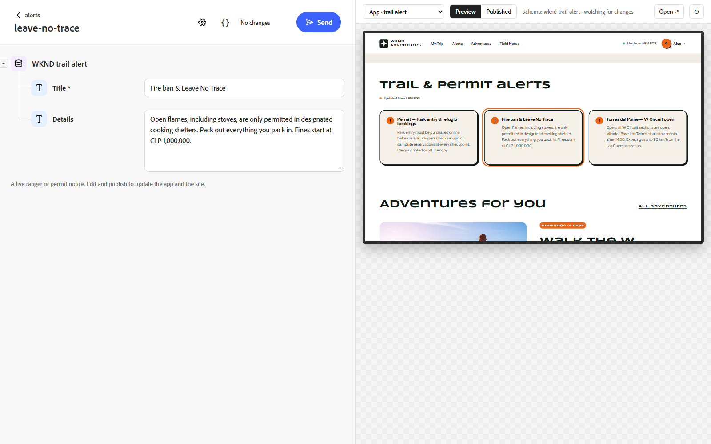

# SC Studio

A Document Authoring (DA) app for **AEM structured content**. It puts the structured content form side by side with a live preview of every channel that uses the record: an app, a kiosk, a website page, a phone view. Authors edit on the left, press **Send**, and the preview on the right refreshes by itself.

It works like a Content Fragment preview URL, but each site configures it, so one copy of this app serves every site. Originally built as Kiosk Studio for the Fréscopa demo.

**App URL:** `https://da.live/app/aemxsc/sc-studio/studio#/<org>/<site>/<path-to-record>`

**New to SC Studio?** Start with the **[team guide](docs/guide.md)**. It has screenshots, a demo talk track, step-by-step setup and troubleshooting.



---

## Use it on a site (two steps)

### 1. Point a records folder at the app (org config)

In `https://da.live/config#/<org>/`, add an `editor.path` row for each folder of records:

| key | value |
|---|---|
| `editor.path` | `/<org>/<site>/<folder>=https://da.live/app/aemxsc/sc-studio/studio#` |

Keep the trailing `#`. The path is case-sensitive. Opening a record in that folder now opens SC Studio instead of the plain form.

### 2. Tell it what to preview (site config)

In the **site** config (`https://da.live/config#/<org>/<site>/`), add a sheet named `previews` with one row per channel:

| schema | label | url | device |
|---|---|---|---|
| `wknd-trail-alert` | App · trail alert | `https://my-app.vercel.app/?tier={tier}&cf={path}` | `desktop` |
| `wknd-trail-alert` | Website · trip companion | `https://main--{site}--{org}.aem.{tld}/trip-companion` | `desktop` |
| `roast` | Kiosk · roast | `https://my-kiosk.vercel.app/?tier={tier}&product={path}` | `kiosk` |

- **schema:** the record's schema name. Rows for the open record's schema are shown. Leave it empty to show the row for every schema.
- **url:** must be `https://`. Tokens:

  | token | value |
  |---|---|
  | `{tier}` | `preview` or `live` (the toggle in the app) |
  | `{tld}` | `page` or `live`, for `aem.page` / `aem.live` |
  | `{path}` | record path, e.g. `/wknd-next/alerts/leave-no-trace` |
  | `{slug}` | last path segment, e.g. `leave-no-trace` |
  | `{org}`, `{site}` | from the record |

- **device:** `kiosk` (1080×1920), `desktop` (1280×800) or `phone` (390×844). The frame scales to fit.

A site without a `previews` sheet still opens the form, with a note saying no previews are configured.

## Choose the form (asset picker)

The structured content form moved from `aemsites/sc-editor` into da-live ([adobe/da-live#1477](https://github.com/adobe/da-live/pull/1477)). Its **asset picker** (image and file fields from AEM Assets, including Dynamic Media) ships there with [adobe/da-live#1520](https://github.com/adobe/da-live/pull/1520). SC Studio can embed either form:

| key | form | picker |
|---|---|---|
| `headless` (default) | stock sc-editor form, hosted inside Studio without a second DA header | no |
| `shell` | the same form as a full da.live page | no |
| `dalive` | the da-live form at `da.live/form` | when #1520 ships |
| `assets` | da-live's `scassets` preview branch | yes, to try it now |

Pick one for a site with a row in the site config's **data** sheet, `sc-studio.form` = `assets`, or for one visit with `?form=assets` on the app URL. Unknown values fall back to the default. Full-page forms sign in by themselves.

For the picker, a field references the SDK's image or file type instead of being a URL string. The stored value becomes an object, `{ src, altText }` for images and `{ src }` for files, so channel apps must read `image.src` as well as a plain string:

```json
"image": {
  "$ref": "https://raw.githubusercontent.com/adobe/da-sc-sdk/main/schemas/image/v1.0.0.json",
  "title": "Image",
  "required": ["altText"]
}
```

AEM Assets appears in the picker when the site config has `aem.repositoryId`. Images are copied into the media bus on preview or publish, like Canvas does, so a later change in AEM shows on the next preview or publish. Files are saved as links and stay in sync.

## How it works

- It hosts the stock form editor (`aemsites/sc-editor`) in an iframe and passes DA's token and the record path to it.
- Every 4 seconds it reads the record from `da-sc` for the selected tier. When the record changes (a Send to preview, or a publish), it reindexes that path in the Structured Content API and reloads the preview.
- The channel URL gets a `studio=<timestamp>` cache-buster on each reload.

Your channel pages must allow being framed by `da.live`. Next.js and EDS pages do by default.

## Sites using it

| Site | Folder | Channels |
|---|---|---|
| `aemxsc/frescopa26` | `/roasts` | Fréscopa kiosk, roast pages |
| `aemxsc/wknd-adventures` | `/wknd-next` | wknd-next-sc app, `/trip-companion` |

## Develop

There's no build step. `studio.html`, `studio.js` and `studio.css` are served as-is by AEM Code Sync from `main`. To try a change before it reaches every site, push a branch. Then open `https://da.live/app/aemxsc/sc-studio/studio?ref=<branch>#/<org>/<site>/<record>`.

The Structured Content API (`sc-api` / `da-sc` workers) is experimental, not a supported product API.
