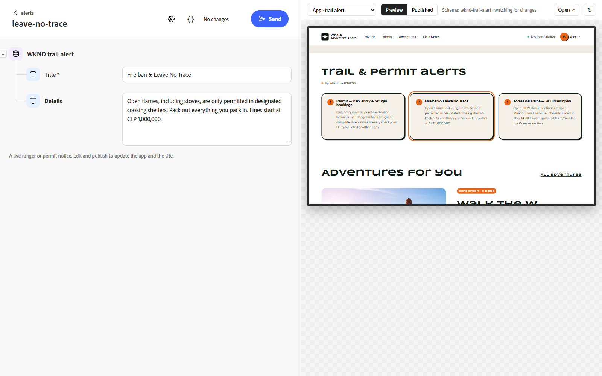
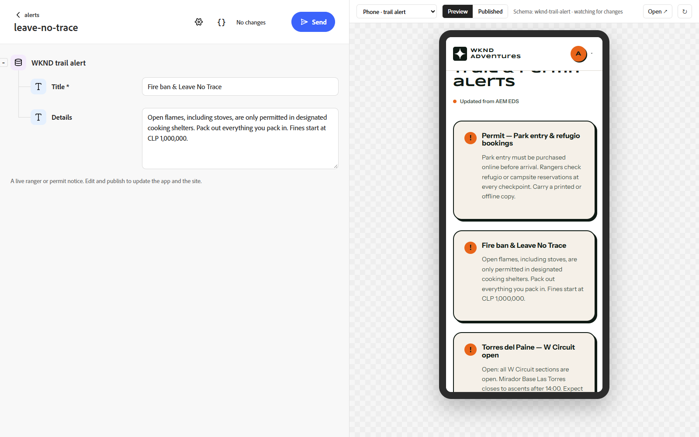
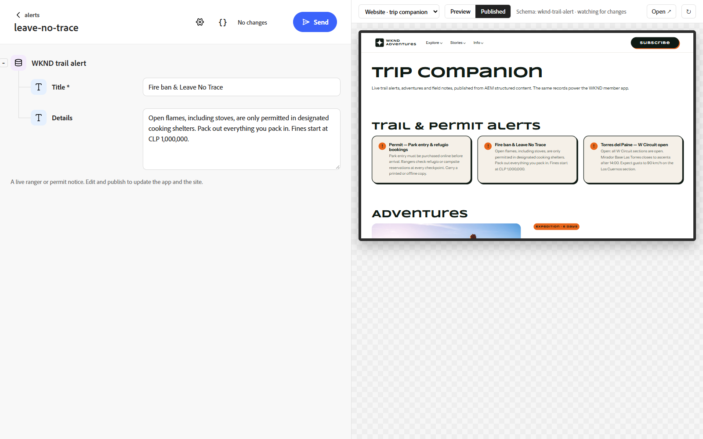
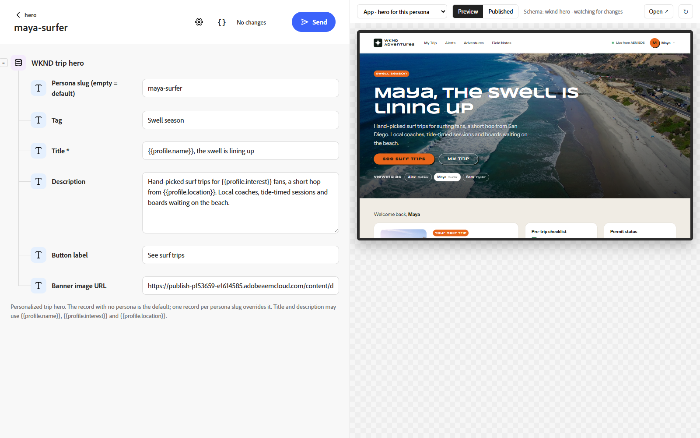
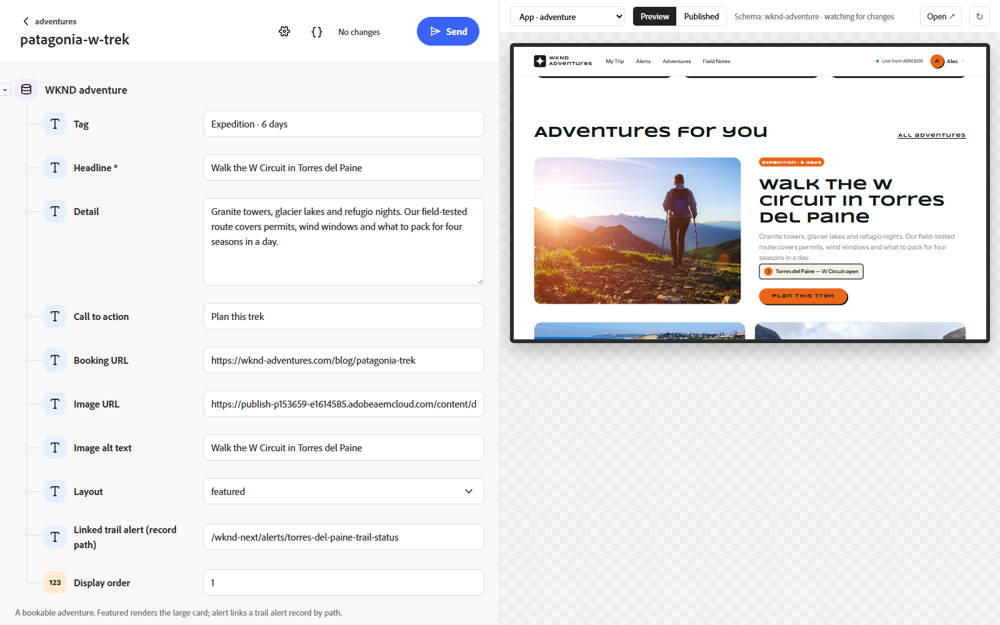

# SC Studio setup guide

*For the XSC team. A shareable web version of this guide also exists; this copy lives with the code so it stays current.*

SC Studio puts the AEM structured content form next to a live preview of every channel that uses the record: an app, a kiosk, a website page or a phone. Authors press **Send** and the preview refreshes on its own. It's the structured-content version of a Content Fragment preview URL.

| | |
|---|---|
| **App URL** | `https://da.live/app/aemxsc/sc-studio/studio#` |
| **Repo** | [AEMXSC/sc-studio](https://github.com/AEMXSC/sc-studio) |
| **Already on** | Fréscopa `/roasts` · WKND `/wknd-next` |
| **Setup per site** | Two config entries, no code |



*A WKND trail alert open in SC Studio. The form is on the left. On the right is the **App · trail alert** channel, with the record highlighted in the app. Inside DA, the DA header sits above this view.*

**Contents:** [Use it in a demo](#use-it-in-a-demo) · [WKND talk track](#wknd-talk-track-3-minutes) · [Set it up on your site](#set-it-up-on-your-site) · [Troubleshooting](#troubleshooting) · [Links](#links)

---

## Use it in a demo

1. **Open a record in DA.** Browse to a records folder that's mapped to SC Studio (for example `/wknd-next/alerts` on wknd-adventures) and open a record. It opens in SC Studio instead of the plain form.
2. **Pick a channel.** The menu at the top right lists only the channels for this record's schema: app, phone or website for a WKND alert. Each one is framed at its real size (desktop 1280×800, phone 390×844, kiosk 1080×1920) and scaled to fit.
3. **Edit, then press Send.** Change a field and press the form's **Send**. Within about 4 seconds SC Studio sees the new version, reindexes that record and reloads the channel. You don't need to refresh anything yourself.
   - **Live form** (`?form=live`, or `sc-studio.form` = `live` in the site config): the channel shows changes as you type, changes save to DA automatically, and **Preview** and **Publish** sit above the form. An app that doesn't listen for drafts updates after **Preview**.
4. **Compare draft and live.** **Draft** shows the previewed version (and live drafts). **Live** shows what visitors see. Use **Open channel ↗** to open the channel full screen in a new tab, and **↻** to reload it.

| Phone channel | Website channel |
|---|---|
|  |  |
| **Phone · trail alert**: the same record in the app at phone size. | **Website · trip companion** on **Live**: the same alert on the EDS site, rendered by the `wknd-sc-list` block. |



*A personalized hero record. The form keeps the `{{profile.name}}` token. The preview resolves it for the persona the record belongs to, so you see **"Maya, the swell is lining up"** with the surf image.*

---

## WKND talk track (3 minutes)

1. **Frame it.** *"WKND keeps its trail alerts as structured content in AEM Edge Delivery. One record feeds the member app, the phone experience and the website."*
2. **Show the record.** Open `/wknd-next/alerts/leave-no-trace`. Point out the typed fields from the schema, and the app preview on the right with that alert highlighted.
3. **Make a change.** Change the fine in the Details field and press **Send**. The app preview refreshes with the new text.
4. **Same content, other channels.** Switch to **Phone**, then **Website · trip companion**. It's one edit on all three surfaces.
5. **Personalization.** Open `/wknd-next/hero/maya-surfer`. The author writes `{{profile.name}}` once and each persona sees their own copy and image.
6. **Optional contrast.** Show the Content Fragment version of the same app at [wknd-next.vercel.app](https://wknd-next.vercel.app), edited in Universal Editor. The app is the same, and only the backend differs.



*A WKND adventure record. **Layout** set to `featured` gives it the large card. **Linked trail alert** points at another record by path, and that alert appears on the card. Change either field, press Send, and the app shows the change.*

---

## Set it up on your site

You need a DA site with structured content: schemas, records, and an index. SC Studio itself takes two config entries and no code.

### 0. Before you start (once per site)

- **Schemas** are made in the schema manager at `https://da.live/app/aemsites/sc-editor/schemas#/<org>/<site>`. They're plain JSON Schema stored at `/.da/forms/schemas/<name>.html`. Use `"x-semantic-type": "long-text"` for multi-line fields.
- **Records** go in one folder per type, for example `/wknd-next/alerts/`. Create them in the form editor, or seed them with a script. For an example, see [`scripts/seed-sc.mjs`](https://github.com/AEMXSC/wknd-next/blob/main/scripts/seed-sc.mjs) in wknd-next.
- **Index:** a new site has no query index until someone builds it, once per tier (`POST https://sc-api.adobeaem.workers.dev/{preview|live}/<org>/<site>/query.json`). After that, each publish reindexes its record.

> **Build the index once, on purpose.** A POST to `query.json` rebuilds the whole index. Channel apps must only ever GET it.

### 1. Map your records folder to SC Studio (org config)

Open `https://da.live/config#/<org>/` and add one `editor.path` row in the **data** sheet for each folder of records. Keep the trailing `#`. The path is case-sensitive.

| key | value |
|---|---|
| `editor.path` | `/<org>/<site>/<folder>=https://da.live/app/aemxsc/sc-studio/studio#` |

Example from aemxsc:

```
/aemxsc/wknd-adventures/wknd-next=https://da.live/app/aemxsc/sc-studio/studio#
```

> **The org config is shared.** Every site in the org reads it, and it also holds permissions. Add your row and leave every other row as it is.

### 2. List the channels to preview (site config)

Open `https://da.live/config#/<org>/<site>/` and add a sheet named exactly **`channels`** with these four columns. The older name, `previews`, also works. `channels` is the name Frescopa Studio reads too. Devices are `phone`, `tablet`, `desktop`, `kiosk` and `car`. Add one row per channel. The WKND rows are below:

| schema | label | url | device |
|---|---|---|---|
| `wknd-trail-alert` | App · trail alert | `https://wknd-next-sc.vercel.app/?tier={tier}&cf={path}` | `desktop` |
| `wknd-trail-alert` | Phone · trail alert | `https://wknd-next-sc.vercel.app/?tier={tier}&cf={path}` | `phone` |
| `wknd-trail-alert` | Website · trip companion | `https://main--{site}--{org}.aem.{tld}/trip-companion` | `desktop` |
| `wknd-hero` | App · hero for this persona | `https://wknd-next-sc.vercel.app/?tier={tier}&persona={slug}` | `desktop` |
| `roast` | Kiosk · roast | `https://frescopa-kiosk.vercel.app/?tier={tier}&product={path}` | `kiosk` |

**URL tokens**

| Token | Becomes | Example |
|---|---|---|
| `{tier}` | the Draft / Live toggle | `preview`, `live` |
| `{tld}` | the matching EDS host | `page` (aem.page), `live` (aem.live) |
| `{path}` | record path | `/wknd-next/alerts/leave-no-trace` |
| `{slug}` | last path segment | `leave-no-trace` |
| `{org}`, `{site}` | from the record | `aemxsc`, `wknd-adventures` |

- **schema** must match the record's schema name. A row with an empty schema shows for every record.
- **url** must start with `https://`. **device** is `phone`, `tablet`, `desktop`, `kiosk` or `car`, and `phone` when it's empty.
- Without either sheet, SC Studio shows the form plus a note saying no channels are configured.
- **Live as you type:** to show drafts before they're previewed, the channel app listens for SC Studio's messages. See "Live drafts" in the [README](../README.md#live-drafts). wknd-next does this.

### 3. Make your channel app read the record (your app)

The preview frame simply loads your URL, so the app decides what `{path}` and `{tier}` mean. The [wknd-next](https://github.com/AEMXSC/wknd-next) app does three things you can copy:

- It reads `?tier=preview` and queries the preview tier: `https://sc-api.adobeaem.workers.dev/preview/<org>/<site>/query.json`.
- It re-reads each record from `https://da-sc.adobeaem.workers.dev/<tier>/<org>/<site><path>`, so an edit shows up before the index catches up.
- It finds `?cf=<path>` through a `data-content-path` attribute, then scrolls to that record and highlights it.

The page must be allowed to load inside a frame on da.live. Next.js and EDS pages allow that by default.

### 4. Check it (2 minutes)

1. Open a record: `https://da.live/app/aemxsc/sc-studio/studio#/<org>/<site>/<folder>/<record>`.
2. The status at the top should read **Schema: &lt;your-schema&gt; · watching for changes**, and the channel menu should list your rows.
3. Edit a field and press **Send**. The preview reloads within a few seconds.

---

## Troubleshooting

| You see | Likely cause | Fix |
|---|---|---|
| The record opens in the plain form, not SC Studio | The `editor.path` row is missing, has no trailing `#`, or has a different case | Fix the row in the org config |
| "No previews configured" | The site config has no `previews` sheet, or no row has a valid url and device | Add the sheet (step 2) |
| The channel menu shows other schemas' rows | No row matches this record's schema, so all rows are shown | Check that **schema** matches the schema name exactly |
| The preview is blank or refuses to load | The channel blocks framing (X-Frame-Options or CSP), or the URL isn't https | Allow da.live to frame it, or use **Open channel ↗** |
| Send works but the preview shows old content | The channel app caches, or reads only the index | Re-read records from da-sc and skip the CDN cache |
| A new record doesn't appear in lists | The site's index was never built | Build it once per tier (step 0) |

> **Experimental API.** The Structured Content API (`sc-api` and `da-sc` workers) is experimental and not a supported product API. Keep those hosts in one constant in your app. There's no asset picker in the form yet, so image fields take a published https URL.

---

## Links

- Try a record: [WKND trail alert in SC Studio](https://da.live/app/aemxsc/sc-studio/studio#/aemxsc/wknd-adventures/wknd-next/alerts/leave-no-trace)
- WKND app on structured content: [wknd-next-sc.vercel.app](https://wknd-next-sc.vercel.app) · on Content Fragments: [wknd-next.vercel.app](https://wknd-next.vercel.app)
- Website page: [wknd-adventures /trip-companion](https://main--wknd-adventures--aemxsc.aem.live/trip-companion)
- App source: [AEMXSC/wknd-next](https://github.com/AEMXSC/wknd-next) (README section "Structured content mode")
- Adobe docs: [Structured content custom editor](https://www.aem.live/docs/ew/administering/structured-content-custom-editor) · [Structured Content API](https://www.aem.live/docs/ew/developing/structured-content-api)

**Changing SC Studio itself:** to test a change before every site gets it, push a branch to this repo and open `https://da.live/app/aemxsc/sc-studio/studio?ref=<branch>#/<org>/<site>/<record>`. Merging to `main` updates every site that uses it.

*Screenshots are real captures of SC Studio running on the live WKND records, taken with Studio hosted outside DA, so DA's top bar is not shown.*
